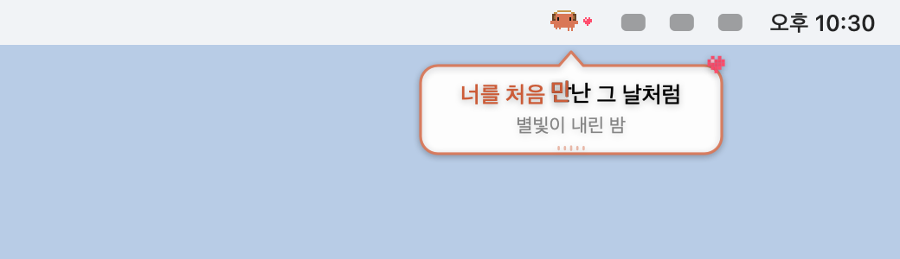
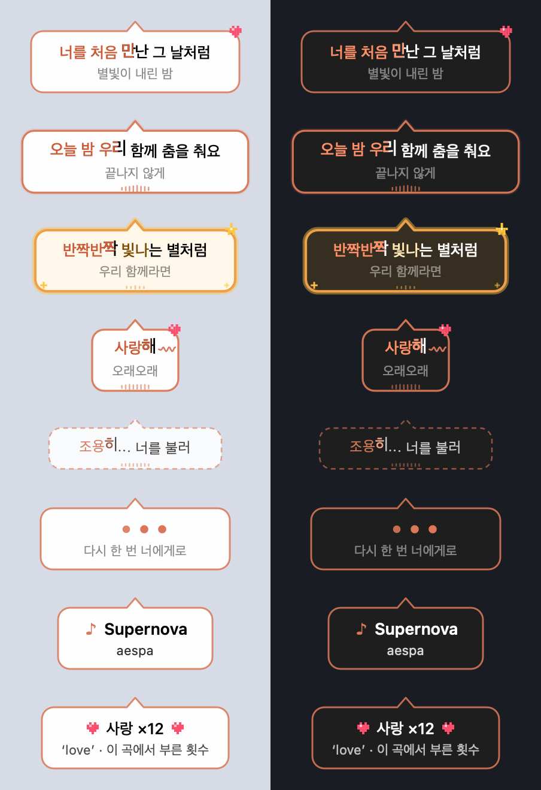
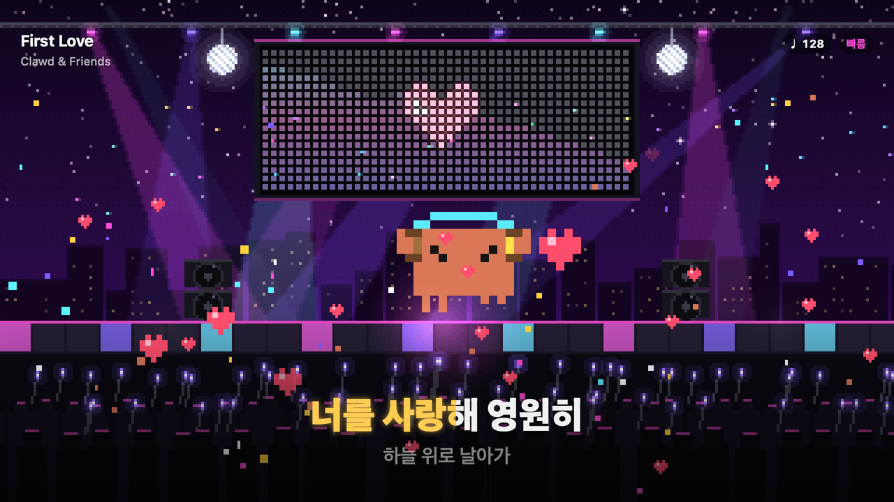
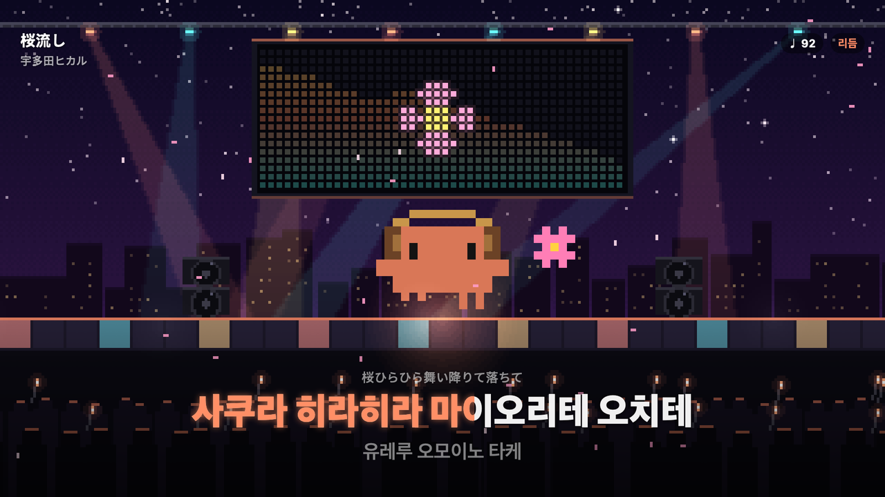

# Claude FM

<picture>
  <source media="(prefers-color-scheme: dark)" srcset="docs/hero-dark.png">
  
</picture>

헤드폰을 쓴 Clawd 가 메뉴바에서 음악을 듣는 macOS 메뉴바 앱. YouTube 의 [Claude FM 라이브](https://www.youtube.com/watch?v=tRsQsTMvPNg)를 재생한다.

- 재생 중에는 Clawd 가 눈을 감고 고개를 까딱이고, 옆으로 음표가 떠오른다. 박자가 잡히면 고개 끄덕임 대신 그 박에 맞춰 점프하고 옆스텝을 밟는다.
- Claude FM 을 멈춰 두었더라도, 맥에서 다른 소리가 나면 눈을 뜬 채로 그 박자에 맞춰 춤추고 음표도 떠오른다. 시스템 설정 > 개인정보 보호 및 보안 > 화면 및 시스템 오디오 녹음에서 시스템 오디오 녹음을 허용해야 한다. 소리는 저장하지 않고 박자와 대역 세기만 본다.
- 분위기도 따라간다. 잔잔하면 살랑이고, 저음이 크면 바닥이 울리고, 고음이 밝으면 반짝이고, 빠르거나 세면 들썩인다. 박을 잡으면 팝오버와 무대에 빠르기(BPM)가 뜬다.
- 음악 앱이 지금 곡을 알려 주면 Claude FM 재생을 자동으로 멈추고, 그 가사를 찾아 메뉴바 아래에 모든 데스크톱에서 보이는 말풍선으로 따라 부른다. 크롬의 유튜브 뮤직도 포함한다. 한국어는 그대로 두고, 다른 언어는 뜻 대신 한국어 발음으로 적는다. 원문과 번역이 함께 적힌 가사는 곡에서 줄 수가 가장 많은 언어만 남긴다. macOS 15.4 이후에는 시스템이 알려 주는 지금 곡을 `/usr/bin/osascript` 로 읽는다. 곡 제목과 가수 이름만 [LRCLIB](https://lrclib.net) 에 묻는다. 제목 뒤의 판본 표시와 괄호 안 다른 표기도 같이 찾는다. 가사 원문과 받은 가사는 디스크에 남기지 않는다. Claude FM 라이브는 곡 정보를 알리지 않아서 말풍선이 뜨지 않는다.
- 노래방처럼 부른 만큼 글자가 코랄색으로 채워진다. 낱말마다 시각이 적힌 가사는 그 시각을 따르고, 줄 시각만 있는 가사는 곡에서 쉼 없이 이어 부르는 줄들로 부르는 빠르기를 재서 줄이 끝나는 때를 어림한다. 간주가 끝나기 네 박 전부터 점이 하나씩 사라지며 다음 줄을 센다.
- 곡이 바뀌면 전주 동안 말풍선에 제목과 가수를 잠깐 띄우고, 후주에는 그 곡에서 가장 많이 부른 반응 낱말을 센다(예: `사랑 ×12`).
- 가사 속 낱말에 반응한다. 사랑·별·불꽃·눈물·달·꽃·햇살·눈을 한국어·영어·일본어·중국어 원문에서 찾아, 그 줄을 부르는 동안 메뉴바 Clawd 의 음표가 하트·별 같은 픽셀 그림으로 바뀌고 말풍선 모서리에 스티커가 붙는다. 이별·작별의 별, 불러의 불처럼 다른 낱말 속 글자는 건너뛴다.
- 되풀이되는 후렴을 찾는다. 후렴 줄에서는 말풍선이 금빛으로 숨 쉬고 Clawd 가 두 팔을 든다. 곡 첫머리가 지난 뒤 후렴 덩어리가 시작하는 박에 메뉴바 아래로 폭죽이 쏟아진다. 사랑 노래면 하트도 섞인다. 시각이 적힌 가사가 없는 곡(Claude FM 라이브 등)은 잔잔하다가 저음과 함께 크게 터지는 드롭에서 터진다. 메뉴바 폭죽은 24초에 한 번까지만 터진다.
- 곡이 끝까지 흐르면 Clawd 가 두 팔을 들고 폴짝폴짝 앵콜 박수를 친다. 무대에서는 관객이 환호하고, 다음 곡 없이 끝났으면 전광판에 ENCORE! 가 깜빡인다.
- 팝오버를 여는 동안에는 말풍선이 숨는 대신 팝오버 안에서 지금 줄을 노래방처럼 채우고, 그 아래 가는 막대로 곡 진행을 보여 준다.
- 블루투스 헤드폰처럼 소리가 늦게 들리면 팝오버에서 가사 싱크를 0.1초씩 옮긴다.
- 팝오버 아래에 오늘 Clawd 와 함께 춤춘 시간과 박 수, 끝까지 들은 노래 수를 보여 준다. 날짜와 숫자만 남기고 자정이 지나면 새로 센다.
- 메뉴바 아이콘 클릭: 영상, 재생/일시정지(스페이스), 음량, 가사 말풍선·필링 효과·노래방 채움·가사 반응 켜고 끄기, 가사 싱크, 무대, YouTube 에서 열기, 종료
- 우클릭(또는 control 클릭): 재생/일시정지, 무대 열기, 가사 말풍선·효과 켜고 끄기, YouTube 에서 열기, 종료
- 팝오버를 닫아도 재생은 계속된다. 영상이 내려가면 Claude 채널의 현재 라이브로 넘어간다.




## 무대



팝오버의 무대 버튼이나 우클릭 메뉴로 Clawd 의 콘서트 무대를 연다.

- 시스템 오디오를 옥타브 여덟 대역으로 나눈 전광판, 박마다 바뀌는 조명과 디스코 바닥, 지금 시각을 따르는 하늘(밤·노을·낮)과 먼 도시가 있다.
- 관객은 박에 맞춰 다 같이 응원봉을 흔들고, 발라드에서는 휴대폰 불빛을 든다. 후렴에서는 모두 응원봉을 높이 들고 네 박마다 색을 바꾼다.
- 가사 반응에 따라 전광판에 큰 그림이 뜨고, 하트가 떠오르고, 비·눈·꽃잎이 내리고, 무대 양옆에서 불꽃이 솟고, 달과 해가 뜬다.
- 가사는 노래방처럼 크게 채우고, 발음과 다른 원문은 위에 작게 단다. 곡이 바뀌면 전광판에 제목을 띄우고, 후주에는 곡 기록을 띄운다. 맨 아래 가는 막대가 곡이 얼마나 흘렀는지 보여 준다.
- 후렴과 드롭에서는 무대 양옆에서 폭죽을 쏘고 무대가 쿵 하고 흔들린다. 무대를 누르면 그 자리에서 폭죽이 솟고 관객이 환호한다.
- 더블클릭(또는 f)으로 전체 화면, ←/→ 로 가사 싱크(시각이 적힌 가사일 때), 0 으로 싱크 되돌리기, 스페이스로 Claude FM 재생/일시정지, ⌘C 로 지금 무대를 이미지로 복사, esc 로 닫는다.
- 무대가 열려 있는 동안은 Dock 에 나오고, 무대가 보이면 말풍선은 쉰다. 창이 가려지면 그리기를 멈추고, 저전력 모드에서는 초당 30번만 그린다. 시스템 설정의 '동작 줄이기'를 켜면 메뉴바 폭죽과 무대 흔들림, 전광판 번쩍임을 쉰다.



## 빌드

```sh
./scripts/build.sh            # build/Claude FM.app
./scripts/build.sh --install  # /Applications/Claude FM.app 로 설치
open "/Applications/Claude FM.app"
```

macOS 13 이상, Xcode 명령줄 도구가 필요하다. 로그인 시 자동 실행은 시스템 설정 > 일반 > 로그인 항목에서 추가한다.

```sh
./scripts/check.sh            # 가사 분석·박 시계·폭죽·전광판 로직 검사
./scripts/preview.sh          # 말풍선·메뉴바 Clawd·무대를 상태별로 build/previews 에 그린다
```

푸시할 때마다 GitHub Actions 가 macOS 에서 앱을 빌드하고, 로직을 검사하고, 미리보기 그림을 `previews` 아티팩트로 올린다.

## 구조

- `Sources/ClaudeFM/ClawdPixels.swift` — Clawd 픽셀 스프라이트와 애니메이션 프레임. 칸 좌표와 색만 낸다
- `Sources/ClaudeFM/ClawdSprite.swift` — 스프라이트를 메뉴바·팝오버 이미지로 칠하기
- `Sources/ClaudeFM/DanceModel.swift` — 분위기, 안무, 춤 상태, 프레임 시계, 오늘의 리듬
- `Sources/ClaudeFM/RadioPlayer.swift` — 보이지 않는 창의 WKWebView 에서 YouTube IFrame API 로 재생
- `Sources/ClaudeFM/PopoverView.swift` — 팝오버 UI
- `Sources/ClaudeFM/BeatClock.swift` — 대역 에너지로 박과 드롭을 찾는 시계
- `Sources/ClaudeFM/SpectrumMeter.swift` — 옥타브 대역 세기를 전광판에 맞게 맞추기
- `Sources/ClaudeFM/SystemAudioTap.swift` — 시스템 오디오를 사적인 프로세스 탭으로 받아 에너지만 넘긴다
- `Sources/ClaudeFM/RhythmDance.swift` — 메뉴바와 팝오버, 무대가 같이 쓰는 춤 상태
- `Sources/ClaudeFM/HangulReading.swift` — 한글이 아닌 가사를 한국어 발음으로 읽기
- `Sources/ClaudeFM/Lyrics.swift` — 가사 시각과 LRCLIB 조회. 메모리에만 둔다
- `Sources/ClaudeFM/LyricInsight.swift` — 노래방 채움 시각 어림, 후렴 찾기, 곡 기록
- `Sources/ClaudeFM/LyricReaction.swift` — 원문에서 가사 반응 낱말 찾기
- `Sources/ClaudeFM/NowPlaying.swift` — 지금 재생 중인 곡의 제목과 위치
- `Sources/ClaudeFM/LyricBubble.swift` — 메뉴바 아래 가사 말풍선
- `Sources/ClaudeFM/LyricSinging.swift` — 곡이 바뀌면 가사를 찾아 현재 줄을 띄우기
- `Sources/ClaudeFM/PixelArt.swift` — 반응 그림, 분위기 색, 폭죽
- `Sources/ClaudeFM/CelebrationOverlay.swift` — 메뉴바 아래 폭죽
- `Sources/ClaudeFM/RasterCanvas.swift` — 무대를 그리는 작은 픽셀 판
- `Sources/ClaudeFM/StageScene.swift` — 무대 장면 그리기
- `Sources/ClaudeFM/StageWindow.swift` — 무대 창과 가사 층
- `Sources/ClaudeFM/AppDelegate.swift` — 메뉴바 아이템, 팝오버, 우클릭 메뉴
- `scripts/render/` — 스프라이트로 앱 아이콘과 미리보기 시트를 그리는 도구
- `scripts/check/` — 화면 없이 도는 로직 검사
- `scripts/preview/` — 말풍선과 메뉴바 Clawd, 무대를 상태별로 그리는 도구

## 디버그

`CLAUDE_FM_DEBUG=1` 로 실행하면 플레이어 상태를 로그로 남기고, 아래 분산 알림을 받는다.

- `io.github.geeksbaek.claude-fm.toggle` — 재생/일시정지
- `io.github.geeksbaek.claude-fm.popover` — 팝오버 열기/닫기
- `io.github.geeksbaek.claude-fm.lyric` — 예시 발음으로 가사 말풍선. `userInfo` 의 `line` 이 있으면 그 글을 띄운다
- `io.github.geeksbaek.claude-fm.stage` — 무대 열기/닫기
- `io.github.geeksbaek.claude-fm.confetti` — 폭죽. `userInfo` 의 `reaction` 에 `love`, `star` 같은 반응을 주면 그 그림도 섞는다
